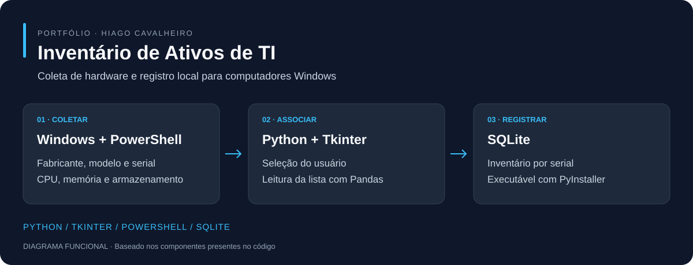

# Inventário de Ativos de TI

**Coleta automatizada de computadores Windows com registro local em SQLite.**



*Diagrama do funcionamento baseado no código; não é uma captura de tela.*

[Instalação](#instalação-no-windows) · [Como usar](#como-usar) · [Tecnologias](#tecnologias) · [Projeto Android](https://github.com/hiagoac7/coletor-dispositivos-android)

## O que o projeto faz

- Associa um usuário ao equipamento por uma lista CSV.
- Consulta fabricante, modelo, serial, processador, memória física e armazenamento com PowerShell/CIM.
- Salva os dados no banco local, usando o serial como chave.
- Permite distribuir a aplicação como executável Windows com PyInstaller.

## Tecnologias

| Componente | Tecnologias |
| --- | --- |
| Aplicação e interface | Python, Tkinter/ttk |
| Lista de usuários | Pandas, CSV |
| Consulta de hardware | PowerShell, Get-CimInstance |
| Armazenamento | SQL, SQLite |
| Distribuição | PyInstaller, Batch |

## Instalação no Windows

Com Git e Python com Tkinter instalados, abra o terminal:

```powershell
git clone https://github.com/hiagoac7/inventario-ti.git
cd inventario-ti
python -m venv .venv
.\.venv\Scripts\python.exe -m pip install pandas pyinstaller
Copy-Item usuarios.exemplo.csv usuarios.csv
.\.venv\Scripts\python.exe coletor.py
```

Edite `usuarios.csv` antes do uso real. Use um nome por linha, na primeira coluna; o leitor aceita separador ponto e vírgula. O exemplo contém somente dados fictícios.

## Como usar

1. Abra o coletor no computador Windows que deseja inventariar.
2. Selecione o usuário responsável.
3. Clique em **RODAR COLETA AGORA**.
4. Confira a confirmação. O arquivo `inventario_ti.db` é criado na pasta do aplicativo.

Uma nova coleta com o mesmo serial substitui o registro anterior. A identificação e a qualidade dos dados dependem das informações fornecidas pelo equipamento ao Windows.

## Gerar o executável

Ative o ambiente e execute o script existente:

```powershell
.\.venv\Scripts\Activate.ps1
.\build.bat
```

O resultado fica em `dist/coletor.exe`. Distribua a pasta `dist` com `usuarios.csv`. O script limpa as pastas `build` e `dist` antes da compilação; guarde cópias dos arquivos necessários.

## Estrutura

| Arquivo | Função |
| --- | --- |
| `coletor.py` | Interface, coleta e gravação |
| `coletor.spec` | Configuração do PyInstaller |
| `build.bat` | Compilação e cópia dos arquivos de apoio |
| `limpar_banco.py` | Manutenção do banco, com backup prévio |
| `usuarios.exemplo.csv` | Modelo fictício da lista de usuários |

## Cuidados e validação

Faça backup do banco antes de qualquer manutenção. `limpar_banco.py` converte campos de texto e remove registros com serial vazio ou `N/A`. Não publique o banco nem a lista real de usuários.

O código e a separação foram revisados; a coleta e a compilação Windows precisam ser verificadas no ambiente de destino. O histórico anterior à separação pode conter dados e configurações antigas do Android.

## Outros projetos

[Coletor Android](https://github.com/hiagoac7/coletor-dispositivos-android) · [Central de Suporte de TI](https://github.com/hiagoac7/Portal-Suporte) · [Sistema ATS](https://github.com/hiagoac7/rh-ats)
